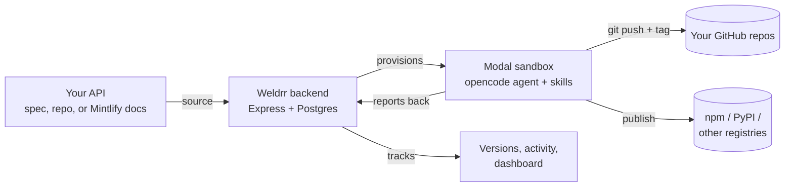
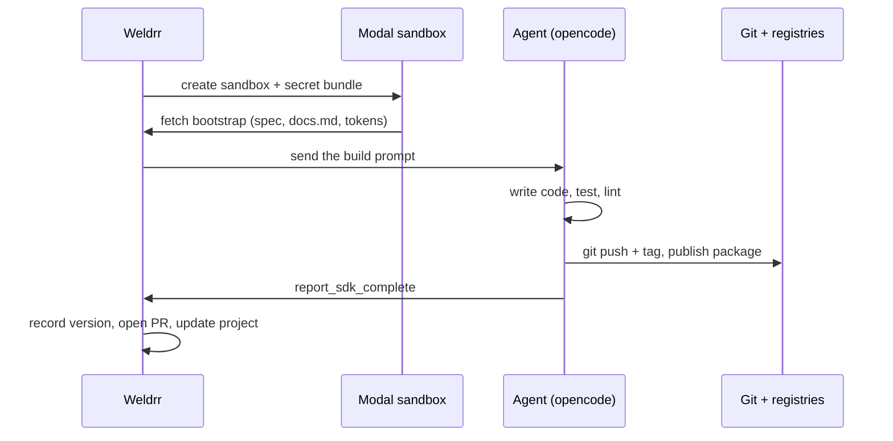

<div align="center">

# Weldrr

**Point it at your API. Get back SDKs, docs, and a CLI.**

[](BACKLOG.md)
[](backend)
[](frontend)
[](BACKLOG.md)

[Quick start](#quick-start) · [What you can do](#what-you-can-do) · [How it works](#how-it-works) · [Publishing](#publishing) · [Project layout](#project-layout) · [Docs](#docs)

</div>

Weldrr reads your API — from a spec, a GitHub repo, or a Mintlify docs site — and
runs an AI coding agent in a cloud sandbox to generate production-grade client
SDKs, a documentation site, and the release plumbing around them. It pushes to
your own repositories, tags versions, and publishes to your package registries.

You don't hand-maintain a spec or regenerate by hand. Weldrr learns what your API
actually does, builds the developer experience from it, and keeps it in sync when
your code changes.



> [!WARNING]
> Weldrr is in active development and not yet hardened for untrusted
> multi-tenant use. The agent in each sandbox has edit, bash and network access
> by design. Read [Good to know](#good-to-know) before exposing an instance.

## Quick start

You need Node 20+, Docker (for Postgres), and a [Modal](https://modal.com)
account to actually run an agent sandbox. You can explore the dashboard without
Modal, but builds won't provision.

```sh
# 1. Start Postgres
docker compose up -d postgres

# 2. Backend — install, configure, run
cd backend
npm install
cp .env.example .env          # set DATABASE_URL and JWT_SECRET at minimum
npm run dev                   # migrations + seed run automatically on boot

# 3. Frontend — in a second terminal
cd ../frontend
npm install
npm run dev
```

Then open <http://localhost:5173>.

1. Sign in with the seeded owner — **admin@weldrr.app** / **admin123**.
2. Connect **GitHub** in Settings → Connections (needed to create artifact repos).
3. Press **New project**, give it a name, and paste a spec or connect a repo.

The backend listens on `:4000` by default (see `PORT`) and serves OpenAPI docs at
<http://localhost:4000/api-docs>.

To build the sandbox image yourself instead of pulling a prebuilt one:

```sh
cd backend
npm run sandbox:image
```

## What you can do

| You want to | How |
|---|---|
| Start from any source | Paste a spec, give a URL, upload a file, connect a GitHub repo, or point at a Mintlify docs site. |
| Understand the API first | Weldrr discovery runs an agent that writes a curated `docs.md` — every endpoint, request body and response. |
| Get SDKs in the languages you ship | TypeScript, Python, Java, Go, Ruby and PHP, one repo per language. |
| Ship a docs site | A React + MDX docs site is generated from the same source and pushed to its own repo. |
| Publish to registries | Packages go to npm and PyPI, with Go, Maven and RubyGems credentials ready to wire in. |
| Review before it lands | `automerge` pushes to main; `pr` opens a pull request the agent's output waits behind. |
| Keep it in sync | A GitHub push webhook re-runs discovery and rebuilds artifacts when the source changes. |
| Version everything | Each finished build is tagged and recorded, so you can see what shipped when. |
| Work as a team | Workspaces, members and roles, encrypted per-workspace provider credentials. |

## How it works

The whole product is one loop: discover, build, publish.



1. **Discovery.** Weldrr provisions a one-shot sandbox that analyzes the target and
   writes `/workspace/docs.md`. The backend reads it back and parses the endpoints.
2. **Builds.** Discovery completion auto-starts one SDK sandbox per language plus a
   docs sandbox (if enabled). Each clones a language template, follows an injected
   skill, then commits and pushes.
3. **Completion.** A dependency-free MCP server in the sandbox exposes
   `report_sdk_complete`. The agent calls it once, the backend records the version
   and moves the project to `ready`.

The agent's behavior lives in versioned Markdown skills that ship with the runtime:

```text
backend/src/sandbox-runtime/
├── startup.sh            # clone template, fetch bootstrap, start opencode web
├── mcp-callback.mjs      # report_sdk_complete → Weldrr API
└── skills/
    ├── discovery-agent/  # turn a repo or docs URL into docs.md
    ├── sdk-builder/      # scaffold, implement, test, publish an SDK
    └── docs-builder/     # populate and build the docs site template
```

## Sources and languages

| Source | What Weldrr does |
|---|---|
| `paste` | A spec pasted into the dashboard. |
| `url` | Fetch a spec, or a Mintlify docs site, from a URL. |
| `upload` | A file uploaded to object storage (Cloudflare R2 / S3). |
| `github` | Clone the repo and analyze the code directly. |
| `mintlify` | Read the Mintlify source and rebuild it as a Weldrr docs site. |

Spec types: **OpenAPI**, **GraphQL**, **gRPC** and **AsyncAPI**.

SDK languages: **TypeScript**, **Python**, **Java**, **Go**, **Ruby**, **PHP**.

## Publishing

Every artifact lands in a repo Weldrr creates and reuses on later runs — `<project>-sdk-<lang>`
and `<project>-docs`. Registries are workspace-scoped connections, encrypted at
rest with AES-256-GCM.

| Registry | Status |
|---|---|
| npm | Injected into the sandbox and published |
| PyPI | Injected into the sandbox and published |
| Go, Maven, RubyGems | Credentials stored; publish wiring in progress ([BACKLOG.md](BACKLOG.md)) |

Published versions are recorded per project, and a docs or SDK build bumps the
tracked version so you always know what's current.

## Project layout

| Path | What's in it |
|---|---|
| [`backend/`](backend) | Express API, agent orchestration, Modal + GitHub + registry integrations, Drizzle schema. |
| [`frontend/`](frontend) | React 19 + Vite dashboard: landing, projects, workspace, settings, docs editor. |
| [`docs-template/`](docs-template) | The React + MDX documentation site the docs agent populates. |
| [`docker-compose.yml`](docker-compose.yml) | Local Postgres 16. |

Configuration lives in [`backend/.env.example`](backend/.env.example). The
required keys are `DATABASE_URL` and `JWT_SECRET`; everything else (Modal, GitHub
OAuth, R2, email, models, sandbox templates) is optional and degrades gracefully.

## How finished is it

| Status | What |
|---|---|
| Solid | Auth and workspaces, projects and discovery, SDK and docs generation through the sandbox pipeline, GitHub push and PR mode, npm/PyPI publishing, activity and versions. |
| In progress | Go/Maven/RubyGems publishing, connection token validation and rotation, CLI artifact generation. |
| Rough edges | Discovery is best-effort on messy codebases, and build cost follows agent run length. |

## Good to know

- The sandbox agent runs with `bash`, `edit`, `webfetch` and network access. It
  works in `/workspace` and pushes with a token scoped to the workspace's GitHub
  connection — not the whole account.
- Sandboxes are billed by Modal and sized for long agent runs (up to 4 vCPU /
  8 GB). The hard timeout is `SANDBOX_TIMEOUT_MS`, one hour by default.
- Volumes aren't used; each sandbox is disposable and artifact state lives in git.
- Credentials are encrypted with `SANDBOX_CREDENTIAL_ENCRYPTION_KEY`, derived from
  `JWT_SECRET` if unset. Rotating it invalidates stored tokens.
- Rate limits: 600 requests/min per IP, 60 per 15 min on `/api/auth`.

The remaining gaps are tracked in [BACKLOG.md](BACKLOG.md).

## Docs

| Guide | What it covers |
|---|---|
| [Backend routes](backend/src/app.ts) | Every mounted API surface and its middleware |
| [Dashboard schema](backend/src/db/schema) | Workspaces, projects, discoveries, sandboxes, versions |
| [Agent pipeline](backend/src/modules/sandboxes/sandboxes.service.ts) | Discovery, auto-builds, callbacks, PR mode |
| [Sandbox runtime](backend/src/sandbox-runtime) | Startup script, callback MCP server, injected skills |
| [SDK builder skill](backend/src/sandbox-runtime/skills/sdk-builder/SKILL.md) | The agent's SDK instructions and completion protocol |
| [Publishing service](backend/src/services/publishing.ts) | Branching, PRs, tags and version recording |
| [Environment reference](backend/.env.example) | Every configuration key |

Interactive API reference: <http://localhost:4000/api-docs> once the backend is up.

## Contributing

Help is welcome. The highest-leverage areas right now:

- Registry publishing for Go, Maven and RubyGems (the pipeline injects GitHub
  credentials only today).
- Validating and rotating connection tokens before they're stored.
- CLI artifact generation to match the SDK and docs builders.
- Discovery quality on large, messy codebases.
- Sandbox lifecycle and API tests.

## License

No license file is included yet. Weldrr is a commercial product — get in touch
before reusing the code.
